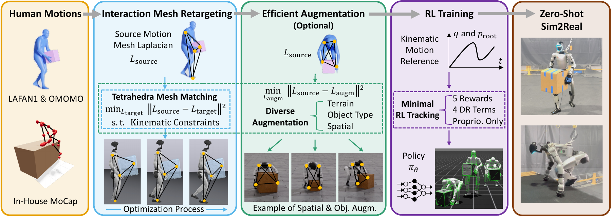
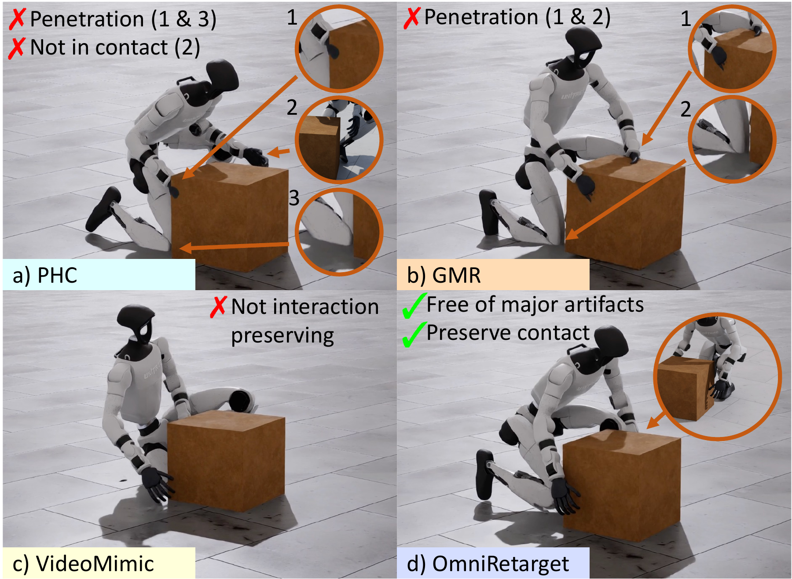
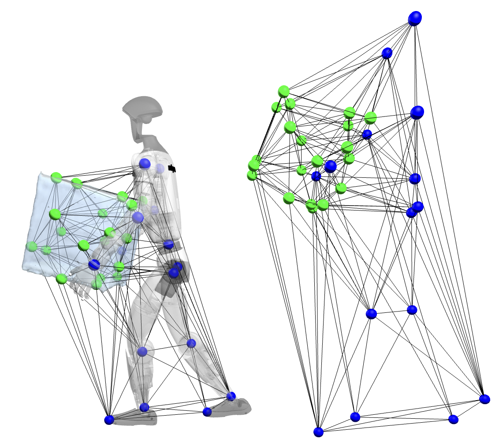
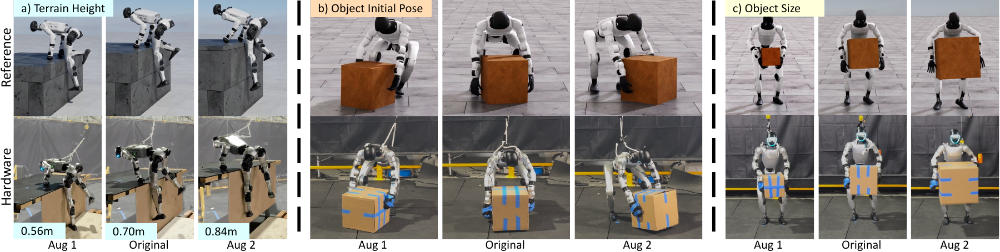

# 从人体示范到人形机器人动作

[OmniRetarget 官方项目主页 ↗](https://omniretarget.github.io/)　·　[RoboMoCap 官方项目主页 ↗](https://bitrobot-foundation.github.io/robomocap/)

> **Overview｜从人的示范到机器人的执行**
>
> **采集人体示范 → 生成机器人参考 → 训练跟踪策略 → 真机执行**
>
> **OmniRetarget** 从已有示范出发，重点是生成保留交互的机器人参考，再用 RL 训练跟踪。**RoboMoCap** 从采集出发，重点是把第一人称影像、全身动捕和物体轨迹对齐，也用自己的数据评估了 OmniRetarget 的重定向结果。

## 1. OmniRetarget｜怎样把动作迁移到机器人

*Yang 等 · arXiv:2509.26633v3*

### 1.1 Overview / Pipeline｜从人体示范到 G1 执行

**原图 Fig. 2。** 从左往右看：输入人体动作和场景几何，用交互网格求解机器人的运动学参考，可选地改变物体或地形后重新求解。最后在仿真中用 RL 训练跟踪策略，再部署到 G1。

### 1.2 手臂短了，怎样还抓得住箱子

**原图 Fig. 7。** 看手和箱壁的位置。即使机器人姿态和人的示范相似，身体比例不同也可能使手穿进箱子或脱离箱壁。重定向时要同时考虑身体与场景的关系。

### 1.3 用交互网格保留手、脚和场景的相对位置

**原图 Fig. 9。** 人体关键点、物体表面点和地形点组成同一个网格。手与箱面之间有邻接关系，优化时就能衡量两者的相对位置是否改变。

$$
L(p_i)=p_i-\sum_{j\in\mathcal N(i)}w_{ij}p_j
$$

$p_i$ 是网格顶点，$\mathcal N(i)$ 是它的邻居，$w_{ij}$ 是归一化邻居权重。**一个点相对邻居中心的偏移**描述局部交互关系。求解机器人构型时尽量保持这类偏移，并约束穿透、关节范围、速度和支撑脚位置。手与箱子的接触主要由网格目标和避碰约束维持。

### 1.4 一条示范怎样扩展到不同场景

**原图 Fig. 4。** 改变箱子初始位姿、尺寸或台阶高度后，在新几何条件下重新求解。例如，同一攀爬示范生成 0.56、0.70、0.84 m 三种高度的参考。

### 1.5 实验说明了什么

在 39 条有挑战性的动作上比较参考生成方法，下游采用相同的 RL 超参数。下表为论文 **Table II** 的仿真结果摘录。

| 任务 | OmniRetarget | 该组成功率最高的基线 | 差值 |
| --- | ---: | ---: | ---: |
| 物体交互 | **82.20%** | PHC 71.28% | +10.92 个百分点 |
| 地形交互 | **94.73%** | GMR 78.94% | +15.79 个百分点 |
| 纯运动 | 100% | Unitree LAFAN1 100% | 持平 |

物体交互里，PHC 和 OmniRetarget 的接触保持均值都是 0.96，最大穿透深度指标从 5.11 cm 降到 1.34 cm。接触分数要和穿透一起看。真机另有搬运、攀爬和约 30 秒连续任务展示，表中百分比来自**下游仿真**。

## 2. RoboMoCap｜怎样采到能监督全身运动的示范

*Deshmukh 等 · arXiv:2611.10994v1*

### 2.1 Overview / Pipeline｜从传感器到同步数据

**[原图 Fig. 3。](https://arxiv.org/pdf/2611.10994v1#page=8)** 从左往右看：先用可穿戴相机、外部相机和光学动捕记录同一次示范，再对齐时钟和坐标，最后输出同步的相机观测、全身动作、手部姿态和物体轨迹。

### 2.2 采了什么，标注从哪里来

**200+ 小时，14 人，8 类、291 种预设动作协议**。移动基本动作、姿态与动态、移动操作合计约占 81%。采集在 7 × 7 m 动捕棚内，覆盖横走、后退、转向、搬运和跨障等动作条件。动作协议数按论文 Table 2。

6 路头戴、2 路腕戴和 1 路外部相机提供 30 Hz 视频。NOKOV 以 120 Hz 跟踪人体反光标记和带标记的刚体。头戴陀螺仪和光学系统都能感知转头，论文用这段共同的运动做时间对齐。

- **身体和脚**：光学标记约束 SMPL-X 拟合，鞋底标记可用于推导接触标签。
- **手指**：多视角视觉估计 MANO，再与跟踪到的腕位姿融合。
- **带标记的刚体**：光学跟踪输出物体位姿，可与同步的人体动作一起分析。

### 2.3 看哪里和往哪里走可以相差 90°

**[原图 Fig. 4C。](https://arxiv.org/pdf/2611.10994v1#page=10)** 头朝向与行进方向的夹角中位数，前走为 **9.5°**，侧走或后退为 **92.4°**。第一人称视角中脚往往不可见，头的观测也难以唯一确定下肢动作。这就是配对光学监督的价值。

### 2.4 三项基准分别在测什么

| 基准 | 看哪个结果 | 如何解释 |
| --- | --- | --- |
| 全身重建（Table 3） | EgoAllo 局部 MPJPE **80.8 mm**。AGRoL 世界坐标误差 **95.4 mm**、序列对齐后 **64.9 mm** | 在各方法的输入配置下，局部人体姿态与整体移动轨迹各有优势 |
| 足接触和落脚（Table 6） | EgoAllo 接触 F1 **90.5%**，脚印误差 **85.1 mm**，步间位移误差 **154.1 mm** | 着地时机和位置精度要分别验收 |
| G1 重定向（Table 4–5） | OmniRetarget 足接触 F1 **87.7%**、打滑率 **2.2%**，片段通过 **53.6%**。PHC 自碰撞帧 **1.1%**，片段通过 **79.6%** | 保真、接触和几何通过率衡量不同问题 |

足接触与 G1 重定向两项评估使用 **543 个测试会话，约 18 小时**。G1 的片段通过要求同时满足根相对误差、最大穿地和自碰撞阈值，属于**离线轨迹评估**。

## 3. 放在一起看｜数据、参考、执行怎么验收

| 阶段 | 重点检查 |
| --- | --- |
| 人体示范 | 影像与动捕同期，分清光学测量、人体模型拟合和视觉估计 |
| 机器人参考 | 分别看落脚误差、接触保持、打滑、穿透与自碰撞 |
| 策略执行 | 用统一训练条件做仿真对照，再单独报告真机表现 |

**两篇最直接的交点**：RoboMoCap 在大量统一输入上评估了 OmniRetarget。它的接触与位置保真表现好，但部分轨迹卡在几何阈值上。OmniRetarget 自身论文则用另一组动作和下游 RL 衡量仿真执行。两组数据和判定口径不同，组会可把它们放到上表的不同阶段来读。

OmniRetarget Fig. 2、4、7、9 截取自 [Yang 等的论文（arXiv:2509.26633v3）](https://arxiv.org/abs/2509.26633v3)，采用 [CC BY 4.0](https://creativecommons.org/licenses/by/4.0/)。RoboMoCap Fig. 3 和 Fig. 4 由 [arXiv 原文](https://arxiv.org/html/2611.10994v1)提供。
